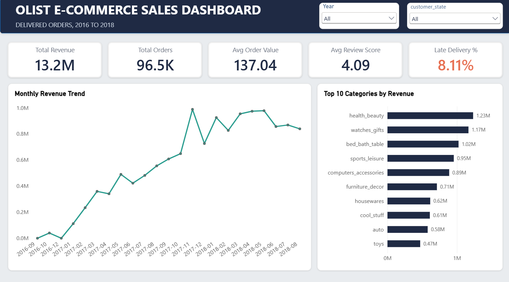
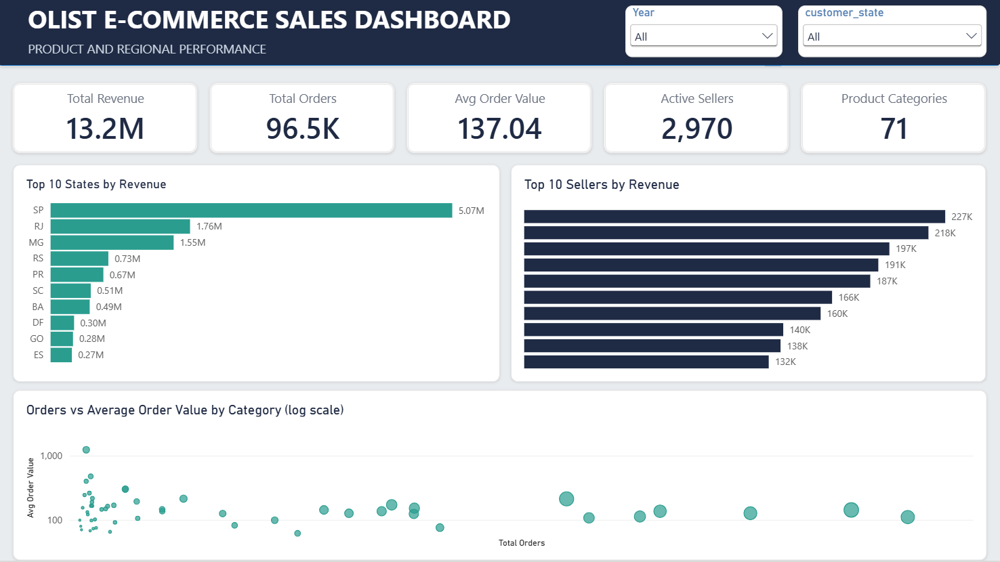
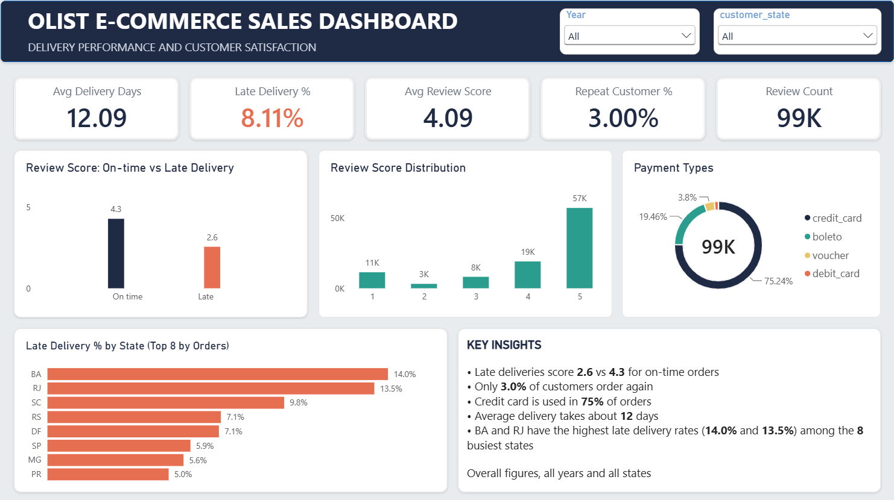

# Olist E-commerce Sales Analysis

End-to-end analysis of a Brazilian online marketplace using **MySQL, Python and Power BI**: from raw CSV files to a 3-page interactive dashboard.

**Author:** Nithika

---

## Project overview

Olist connects small businesses with customers across Brazil. This project analyses about **100,000 orders placed between 2016 and 2018** to understand sales trends, product performance, delivery quality and customer satisfaction.

**Dataset:** [Brazilian E-Commerce Public Dataset by Olist](https://www.kaggle.com/datasets/olistbr/brazilian-ecommerce) (Kaggle). It is anonymised, and 8 of the 9 files were used (the geolocation file was not needed).

## Business questions

1. How do orders and revenue change over time, and when are the peaks?
2. Which product categories and states drive the most revenue?
3. How good is delivery performance, and does late delivery hurt customer satisfaction?
4. How do customers pay?
5. How many customers come back to buy again?

## Tools used

| Area | Tools |
|---|---|
| Database and analysis | MySQL 8.0 (joins, aggregations, CTEs, subqueries, CASE) |
| Data cleaning | Python (pandas, SQLAlchemy, PyMySQL) in Jupyter Notebook |
| Data model and dashboard | Power BI (Power Query, data model, DAX, time intelligence) |

## Approach

1. **Load:** imported the CSV files into MySQL (the large reviews file was loaded with Python because of line breaks inside the comments).
2. **Explore with SQL:** answered the business questions with joins across up to four tables.
3. **Clean with Python:** checked missing values and duplicates, converted text columns to real dates, labelled products with no category as `unknown`, and added calculated columns (delivery days, late flag, order month and year).
4. **Model:** built a snowflake-style data model in Power BI with `order_items` as the fact table, plus a calendar table for time intelligence.
5. **Visualise:** built a 3-page dashboard with DAX measures and slicers (Year and State).
6. **Validate:** compared the Power BI results with the SQL results.

## Dashboard

The Power BI file (.pbix) is not included because of its size. It is available on request.

### Page 1: Overview


### Page 2: Products and Regions


### Page 3: Customers and Delivery


## Key insights

All figures are for **delivered orders** unless stated otherwise. Revenue is product price only (freight is not included).

**Sales and growth**
- Orders peaked in **November 2017** (7,544 orders), in line with Black Friday.
- Revenue grew about **21% from 2017 to 2018** (about 5.96M to 7.22M), even though 2018 has fewer months of data. Average order value stayed around 137, so growth came from more orders, not bigger baskets.

**Products and regions**
- The top categories by revenue are **health_beauty (1.23M)**, **watches_gifts (1.17M)** and **bed_bath_table (1.02M)**.
- Categories behave differently: bed_bath_table is high-volume with a lower order value, while computers is a niche, high-ticket category with a much higher average order value.
- **São Paulo (SP)** has about 42% of orders (41,746), and the top three states (SP, RJ, MG) have about 67%.
- Revenue is spread across many sellers: the top seller earns about 227K, roughly 1.7% of the total.

**Delivery and satisfaction**
- Delivery takes about **12 days** on average, and **8.1%** of orders arrive later than the estimated date.
- Late orders average a review score of **2.6**, versus **4.3** for on-time orders, a gap of 1.7 points.
- Among the 8 busiest states, **BA (14.0%)** and **RJ (13.5%)** have the highest late delivery rates.

**Customers and payments**
- Only **3.0%** of customers (2,801 of 93,358) ordered more than once, so retention is a clear opportunity.
- **Credit card** is used in about 75% of orders and **boleto** (a Brazilian bank-slip payment) in about 19%.

## Data quality notes

- No duplicate rows were found in any table.
- Missing values were mostly expected: undelivered orders have no delivery date, and most reviews have no comment text.
- About 610 products had no category and were labelled `unknown`.
- Power BI totals matched SQL exactly for overall and yearly revenue and orders. Small differences in category figures came from the delivered-orders filter.
- Average delivery time is 12.5 days in SQL (which counts calendar days) and 12.09 days in pandas (which counts full 24-hour days).

## Limitations

- The data starts in September 2016 and ends in late 2018, so the first and last months are incomplete and were not used for trend comparisons.
- There is no cost or profit data, so the analysis covers revenue, not profitability.
- The link between late delivery and low review scores is an association, not proof of cause.

## Repository structure

```
olist-ecommerce-sales-analysis/
├── SQL/SCRIPT/        SQL script
├── PYTHON/            Python notebooks (data cleaning)
├── POWERBI/
│   └── screenshots/   dashboard images
│                      (Power BI file available on request)
└── README.md

The raw data is not included: download it from Kaggle (link above).
```

## Skills demonstrated

SQL (joins, CTEs, subqueries, CASE, aggregations) | Python (pandas, data cleaning, date handling) | Power BI (data modelling, DAX, time intelligence, dashboard design) | Data validation | Business storytelling
